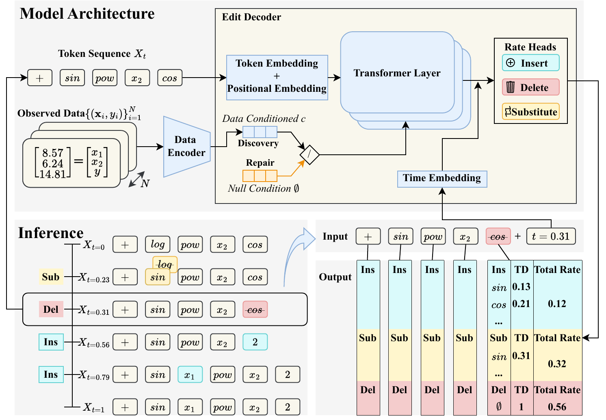

# EditFlowSR

Source code for **EditFlowSR**, a symbolic regression method that recovers
closed-form expressions from observed data through iterative expression
editing: starting from a random token sequence, the model applies insertion,
deletion, and substitution edits governed by a continuous-time edit process
with learned rate functions.



*Overview of EditFlowSR. The upper part presents the model architecture: the observed data provide the data condition for the discovery trajectory, the repair trajectory uses the null condition, and both trajectories share the editing backbone. The lower-left part illustrates the inference process: starting from a random sequence, EditFlowSR edits it into the final expression. The lower-right part shows the model inputs and outputs: given the current sequence and time, the model predicts the total rates of insertion, deletion, and substitution, together with token distributions for insertion and substitution.*

The `editflowsr/` package contains the model, the edit-process sampler, and
the expression environment.

## Installation

```bash
pip install -e .
```

A CUDA GPU is recommended; CPU works but is slow.

## Quickstart

1. Download the pretrained checkpoint to `weights/editflowsr_pretrained.pth`
   (see `download_weights.py`).
2. Run `demo.ipynb`. It fits two toy functions end to end and reports the
   recovered expressions with R2, no dataset required.

## License

This project is released under the MIT License. If you use EditFlowSR in
your research, please cite the paper.
